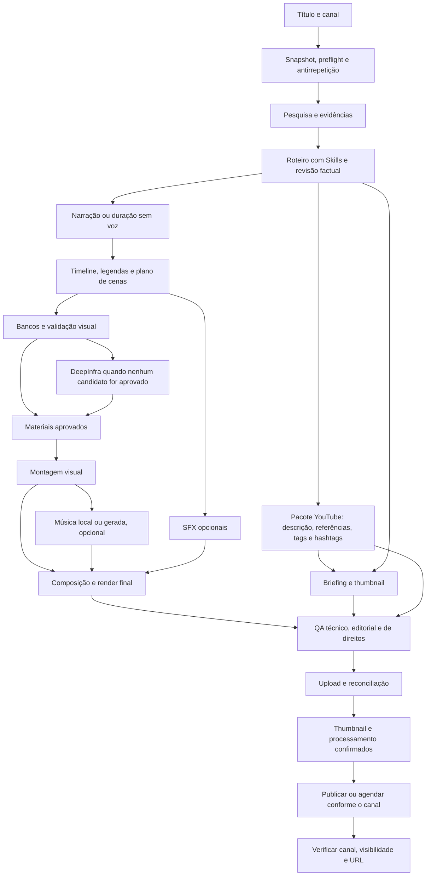

# AUDITORIA — MPT AUTOPILOT

**Data:** 11/11/2026 · **Fuso de referência:** America/Sao_Paulo  
**Tipo de entrega:** diagnóstico e projeto de arquitetura; nenhuma implementação do AUTOPILOT.  
**Conclusão:** o projeto tem uma base de produção de vídeo reutilizável, mas ainda não reúne pesquisa verificável, perfis independentes de canal, fila durável de ponta a ponta, controle de qualidade obrigatório e publicação reconciliável em um único fluxo automático.

## 1. Base examinada, método e limites da conclusão

### 1.1 Código principal da auditoria

A fonte principal foi a cópia local de trabalho em `/workspace/work/automa-o01`, confirmada pelo proprietário nesta conversa como **a mesma versão de sua instalação com o ajuste DeepInfra**. Não foi usado o MoneyPrinterTurbo original como substituto dessa cópia.

Identificação da base:

- Commit de origem da cópia: `a75d8e8bc0168b13aa481b71ee8c8bdacb1738bf`.
- Inclui o ajuste DeepInfra sem limite, entregue anteriormente no commit `fdc51e3e360a8c93df619092d8f05d22ca4c37a9`, branch `codex/deepinfra-sem-limite`, PR #1.
- O checkout local mantém esse ajuste como alterações sobre o commit de origem. Portanto, apenas executar `git rev-parse HEAD` não identifica todo o código auditado.
- SHA-256 do `git diff --binary` da cópia examinada: `573afe9b3d798df80ab141c92108103a12f98e495f31a52ae32d9334a94bf996`.
- O arquivo `mixed-scenes.json` e os logs fornecidos anteriormente demonstram uso real do pipeline misto: 168 cenas com mídia registrada, 280 planejadas e interrupção na cena 169 quando o orçamento de imagens estava esgotado. Isso não comprova qualidade ou integridade de todos os arquivos do Windows.

Foram inventariados estruturalmente os 113 arquivos Python de `app`, 16 de `webui`, quatro de `scripts`, os pontos de entrada da raiz e os utilitários Python em `docs`. A biblioteca de testes tem 290 arquivos Python. A investigação detalhada concentrou-se nos caminhos que atendem às 15 etapas solicitadas, persistência, publicação, credenciais, parâmetros e integrações. Não se trata de uma certificação linha a linha de segurança de todos os provedores acessórios.

Também foram consultados dependências, configuração de exemplo, documentos internos, testes e documentação pública dos provedores. Documentos internos antigos foram tratados como evidência histórica, e não como instruções para substituir integrações atuais. O comportamento executável prevalece sobre descrições desatualizadas.

### 1.2 O que foi e o que não foi validado

| Nível de evidência | Significado neste documento |
|---|---|
| Código examinado | A função e sua ligação com o pipeline foram localizadas. |
| Teste controlado | Comportamento exercitado com mocks, arquivos temporários, FFmpeg ou interface Streamlit, conforme o teste. Não comprova acesso à conta do usuário. |
| Contrato público | Endpoint, parâmetros ou condições encontrados em fonte oficial consultada nesta data. |
| Operação real da conta | Exigiria credenciais, saldo, permissões e uma execução autenticada no ambiente de produção. **Não foi realizada nesta auditoria.** |

Não houve geração paga, publicação de vídeo, alteração de configurações da instalação do Windows ou implementação de novos recursos. Dependências de teste foram instaladas somente no ambiente virtual de auditoria. A instalação física do Windows, seus tokens, saldo, fontes, GPU e Agendador de Tarefas não estão acessíveis aqui.

**Google Flow está fora da arquitetura proposta.** Seus módulos existentes são apenas registrados como legado a preservar; não serão chamados pelo AUTOPILOT. Nenhuma funcionalidade foi removida para satisfazer essa exclusão.

## 2. Diagnóstico das 15 etapas desejadas

| Etapa | Situação atual | Evidência e trabalho necessário |
|---|---|---|
| 1. Pesquisa com fontes confiáveis | Parcial | `reference_research.py` analisa transcrições fornecidas; `editorial.research()` organiza observações fornecidas, inclusive Nexlev. Historical Archive Finder pesquisa acervos visuais. Falta descoberta e leitura de fontes factuais, evidências por afirmação e política de confiabilidade por nicho. |
| 2. Roteiro com Skill | Implementado no pipeline de vídeo; ligação editorial incompleta | `channel_skills.py`, `channel_skill_runtime.py`, `llm.py` e `task.start()` congelam e aplicam Skills. O workflow editorial separado não recebe automaticamente todo esse contexto. |
| 3. Descrição com referências ao final | Parcial | Existem captions/metadados sociais. Não há montagem obrigatória de referências a partir de fontes verificadas nem teste de sua preservação até a publicação. |
| 4. Tags e hashtags | Parcial | `generate_social_metadata()` entrega título, caption e hashtags. No cross-post, hashtags são reaproveitadas como tags; faltam campos independentes e validação específica do YouTube. |
| 5. Narração IA | Implementada para vários provedores | `voice.py` e `task.generate_audio()`. AI33 TTS ainda não está ligado ao pipeline local. |
| 6. Imagens e vídeos | Implementada | Bancos, modo misto, DeepInfra, caches, seleção por contexto e proveniência. A retomada e o modo sem limite DeepInfra já existem na base auditada. |
| 7. Efeitos sonoros | Ausente como etapa própria | Não foi localizado um planejador/gerador de SFX integrado à timeline final. Capacidade externa de um provedor não equivale a integração local. |
| 8. Música de fundo | Implementada, com automação parcial | Biblioteca local, upload, seleção aleatória, playlist, Sonilo e ElevenLabs Video-to-Music. Falta política por canal, licença registrada e tratamento obrigatório conforme a configuração. |
| 9. Sincronização | Parcial | Duração de áudio, cortes em frames, SRT, composição e trilha de fundo existem. Faltam pistas independentes de SFX, ducking geral, sincronização semântica e verificação final de alinhamento. |
| 10. Legendas | Implementada | Edge/Whisper, áudio externo, estilos, animação, limites de linhas e integração com renderização. Transcrição AI33 é possibilidade adicional, ainda não implementada. |
| 11. Thumbnail | Parcial | `deepinfra_image.generate_thumbnail()` produz 1280×720, com controle explícito na interface. Não integra automaticamente título, identidade do canal, avaliação editorial e upload da thumbnail. |
| 12. Render final | Implementada | FFmpeg/MoviePy, capítulos, concatenação, codec fallback, trilha e legendas. `video_project.py` oferece renderização local por revisões, isolada do fluxo principal. |
| 13. Qualidade automática | Parcial | Inspeção visual de candidatos e validações técnicas locais. Não há um gate final que impeça publicar por falha de voz, música obrigatória, conteúdo incompleto, thumbnail incoerente ou problemas de direitos. |
| 14. Publicação no YouTube | Parcial | Upload-Post já publica e consulta tarefas assíncronas. Falta seleção independente de canal, idempotência durável, qualidade obrigatória e reconciliação após reinício. |
| 15. Link publicado | Parcial | Respostas e resultados de cross-post podem conter dados remotos. Não há contrato único que só termine após confirmar vídeo, canal, processamento, visibilidade e URL. |

**Não é necessário reescrever o renderizador. O maior trabalho é conectar os módulos com contratos, estado durável e critérios de aceitação.**

## 3. Componentes existentes e limites encontrados

### 3.1 Pipeline de produção

`task.py` já coordena preflight, roteiro, termos, áudio, legendas, materiais e renderização. `stop_at` permite parar em etapas intermediárias. A conclusão da renderização é separada da publicação: a tarefa de vídeo pode ficar completa enquanto o cross-post ainda está processando ou falhou.

O modo misto tem planejamento de cenas, ordem narrativa, pacing variável, seleção de bancos, cache, hashes e proveniência. `visual_validation.inspect_clip()` analisa três frames reduzidos contra a passagem narrada e só aprova com relevância e confiança mínima de 0,8. Uma falha da API visual não aprova o vídeo. Essa amostragem não comprova a qualidade de todo o clip nem do vídeo final.

O ajuste DeepInfra sem limite ignora o teto numérico quando a opção específica está ativa. Continua priorizando bancos e preservando cenas concluídas. **Sem limite de quantidade não significa chamadas gratuitas ou limites de serviço inexistentes.** O número de cenas, rate limits, saldo e falhas ambíguas continuam relevantes.

### 3.2 Retomada e recuperação já presentes

| Componente | O que já preserva | O que ainda falta para o AUTOPILOT |
|---|---|---|
| `mixed_resume.py` | Roteiro, áudio, legenda, manifesto, hashes, cenas prontas, contador e pedidos anteriores | Descoberta automática do projeto, política de retry e acionamento na inicialização. A interface pede UUID. |
| `long_form.py` | Manifesto de capítulos, fingerprints e reaproveitamento de resultados | Coordenação com metadados, thumbnail, QA, publicação e catálogo global de jobs. |
| `ai33/images.py` | Intenção antes do POST, task_id, lock, download validado e retomada de imagem | Generalizar estado remoto para áudio/SFX sem assumir `type=imagen2`. |
| `deepinfra_image.py` | Ledger por imagem, resposta local e reutilização por hash | Resultado ambíguo sem resposta local não é automaticamente reconciliável. UUID local não prova existência de uma tarefa consultável na API DeepInfra. |
| `editorial.py` | `workflow.json`, fingerprint e persistência de etapas editoriais | Pesquisa factual automática e ligação durável ao job de vídeo/publicação. |
| `video_project.py` | Grafo por revisões, invalidação por dependências e artefatos verificados | Integração opcional e incremental com o pipeline de produção. Não deve virar um segundo renderizador obrigatório. |
| `state.py` | Estado em memória ou Redis | Memória desaparece no reinício; durabilidade Redis depende de operação e configuração externa. Não é um journal transacional de todas as etapas. |
| Gerenciadores de tarefa | Fila limitada, concorrência e, no Redis, leases/heartbeat de slots | Lease de capacidade não recupera automaticamente uma etapa já retirada da fila e interrompida durante efeito externo. |

A recuperação atual de cross-post (`recover_interrupted_cross_posts`) marca execuções órfãs como falhas e preserva os vídeos. Não busca o resultado remoto e não continua toda a produção automaticamente. Além disso, `mixed_resume.run()` finaliza e retorna os vídeos sem passar pelo agendamento normal de cross-post; `long_form.py` declara que capítulos não são publicados automaticamente. A automação não pode depender de que essas rotas acionem a publicação da mesma maneira que uma geração nova.

### 3.3 Skills e memória editorial

A biblioteca local importa `SKILL.md`, valida identificação, tamanho e YAML, guarda revisões e congela o conteúdo com SHA-256 no projeto. Suporta até oito Skills, com limite combinado de 48.000 bytes. As instruções são declarativas: não autorizam comandos, mudança de voz/provedor, aumento de orçamento ou publicação. Referências citadas dentro de uma Skill não são carregadas automaticamente.

`llm._generate_response()` aplica as instruções pelo contexto editorial ou snapshot explícito. Isso permite reaproveitar a seleção para roteiro, descrição, tags e briefing de thumbnail. Porém:

1. A presença de uma Skill não torna uma fonte factual verdadeira.
2. O workflow editorial deve receber um snapshot explícito, em vez de depender de contexto global.
3. `_schedule_cross_post()` envia título/roteiro/idioma para outra thread, sem transportar o snapshot de Skills. Portanto, não se deve presumir que os metadados gerados no cross-post obedecem à Skill do roteiro.
4. Metadados não devem ser recriados silenciosamente durante a publicação: o pacote editorial aprovado precisa ser um artefato versionado.

`story_intelligence.py` tem análise, registro de afirmações, requisitos de evidência e memória antirrepetição. Mas `SKILL_ID='beyond-the-archives'` e `save_memory()` exigem o canal “Beyond the Archives”. A heurística também privilegia eventos históricos. Isso deve virar uma estratégia opcional de nicho sobre uma memória genérica por `channel_id`, preservando o formato existente por um adaptador de migração.

### 3.4 Música, voz e sincronização

A base já aceita voz sintetizada, áudio enviado e opção sem voz. Existe geração de áudio silencioso para certos fluxos; isso não equivale a uma decisão editorial de duração para qualquer vídeo sem narração.

A música pode vir de biblioteca local, arquivo enviado, seleção aleatória, playlist com até 20 faixas, ElevenLabs ou Sonilo. Volume nulo/zero evita chamadas desnecessárias. A mixagem usa pistas de áudio, volume, loop quando aplicável e fade final. Ainda falta ducking geral baseado na narração e uma pista por efeito com posição temporal explícita.

**Achado de publicação:** falha na geração ou mixagem de música pode resultar em vídeo concluído sem BGM, acompanhado de warning. É comportamento útil no modo manual, mas precisa ser interpretado pelo AUTOPILOT: se música for obrigatória para aquele canal, essa saída não poderá ser publicada.

## 4. Avaliação das integrações e APIs

### 4.1 Resumo de disponibilidade

| Integração | Implementação local | Contrato/condições públicas | Verificação real desta auditoria |
|---|---|---|---|
| DeepInfra | Imagens FLUX.1 Schnell e SDXL Turbo, thumbnail, ledgers e 429 | API oficial; Bearer; tarifa por modelo/dimensões/iterações | Catálogo público respondeu HTTP 200; geração autenticada não realizada. |
| Pexels | Busca de vídeos, escolha de rendition, cache e proveniência | API key no header Authorization; cotas e atribuição | Documentação oficial verificada; chave e cota da conta não testadas. |
| Pixabay | Busca de vídeos, cache e proveniência | API key em query; limites, cache e restrições de uso | Documentação oficial verificada; conta não testada. |
| Codex | OAuth, modelos e texto; módulos antigos de imagem ainda presentes | Login/plano/capacidades sujeitos à conta e ao produto | Testes de texto/auth controlados; geração de imagem local está explicitamente bloqueada. |
| ChatGPT Native OAuth | Registro/login próprio, perfis, refresh e Responses | Uso de plano em apps participantes depende de elegibilidade, permissão e allowance | Testes controlados; elegibilidade e saldo reais não comprovados. |
| OpenAI API | Texto e validação visual | Cobrança e limites por projeto/modelo; não inferir suporte visual do login ChatGPT | Sem chamada paga. A inspeção visual atual requer configuração OpenAI-compatible própria. |
| AI33/OpenSpeaker | Cliente local de imagens | Documentação pública atual também oferece voz, SFX, STT e música | GETs de health, vozes e créditos responderam 401 sem chave; isso prova acesso ao host, não saldo nem funcionamento autenticado. |
| ElevenLabs | TTS e Video-to-Music | API oficial, modelos e permissões por plano | Contrato consultado e testes controlados; conta não testada. |
| Sonilo | Video-to-Music | API oficial com catálogo de serviços, uso e preço por saída | Contrato consultado e testes controlados; conta não testada. |
| Upload-Post | Upload e polling multirrede, inclusive YouTube | API key, perfil conectado, permissões e limites do plano | Histórico respondeu 401 sem chave; publicação não realizada. |
| YouTube Data API direta | Adaptador dedicado não localizado | OAuth, upload retomável, thumbnails e consulta de processamento | Documentação oficial verificada; OAuth/canal/quota reais não testados. |

Os demais provedores encontrados — Grok, Runware legado, Wavespeed, Volcengine/Seedance, Jalapeno, OFox, Infistar, MuAPI, LoomLoom, Metaso/MiniMax e provedores de voz — devem permanecer disponíveis. Sua presença no código não é certificação de disponibilidade comercial atual. Não são dependências obrigatórias do MVP proposto.

### 4.2 DeepInfra

Arquivos: `app/services/deepinfra_image.py`, `mixed_materials.py`, `mixed_resume.py`, `webui/deepinfra_settings.py`.

- FLUX: `POST https://api.deepinfra.com/v1/openai/images/generations`.
- SDXL: rota de inference do modelo `stabilityai/sdxl-turbo`.
- Autenticação: `Authorization: Bearer ...`.
- FLUX envia `model`, `prompt`, `n=1`, `size` e `response_format=b64_json`.
- O ledger impede repetição automática de um POST pago cujo resultado não foi confirmado.
- Há cooldown para HTTP 429 e reaproveitamento de imagem íntegra.

**Detalhe de parâmetros:** `deepinfra_steps` é usado no payload SDXL. O caminho FLUX OpenAI-compatible não o envia. Assim, a quantidade de passos exibida/configurada localmente não deve ser usada para afirmar um custo exato do FLUX; é preciso conferir defaults e cobrança efetiva do endpoint.

A página oficial de FLUX consultada lista preço-base de **US$ 0,0005 × (largura/1024) × (altura/1024) × iterações**. Isso é referência de planejamento nesta data, não orçamento contratado nem prova de quanto a conta pagará. Rate limits concretos dependem da conta/modelo; registrar 429 e `Retry-After`, sem inventar uma cota fixa. [Fonte oficial DeepInfra](https://deepinfra.com/black-forest-labs/FLUX-1-schnell/api).

### 4.3 Pexels e Pixabay

Pexels usa no código a rota atual `/v1/videos/search`, evitando a rota antiga em depreciação. A documentação lista limites padrão de 200 requisições/hora e 20.000/mês, com possibilidade de aumento solicitado ao provedor. Deve existir link/atribuição conforme as diretrizes da API; não distribuir apenas a mídia sem metadados de origem. [Documentação Pexels](https://www.pexels.com/api/documentation/).

Pixabay usa `/api/videos/`. A documentação lista 100 requisições por 60 segundos e exige cache por 24 horas; também restringe consultas automatizadas em massa e downloads sistemáticos. Isso exige projetar cache, limite por job e uso compatível, em vez de tratar o catálogo como autorização irrestrita para um robô de downloads. A existência de músicas/SFX no site não demonstra uma API pública equivalente para esses conteúdos. [Documentação Pixabay](https://pixabay.com/api/docs/).

Guardar separadamente: referências factuais do roteiro e créditos/licenças das mídias. Um vídeo ilustrativo de banco não é evidência factual do evento narrado.

### 4.4 Codex, ChatGPT e Skills

A base diferencia Codex OAuth (`codex_oauth.py`) de Native OAuth (`chatgpt_auth.py`/`chatgpt_oauth.py`) e da API OpenAI por chave. O Native OAuth usa perfis e refresh próprios; o adaptador Codex usa o endpoint de Responses do serviço Codex. Não são credenciais intercambiáveis.

**Achado confirmado:** `codex_image.generate_image()` termina chamando `reject_legacy_generation()`. O módulo existe, mas novas imagens Codex não estão funcionais nessa versão. Rotas antigas de imagem em `material.py` também são bloqueadas pela política. Isso já ocorre no commit anterior ao ajuste DeepInfra e não foi introduzido por esta auditoria.

O texto por Codex/ChatGPT pode continuar sendo selecionado conforme as integrações existentes. A documentação oficial atual admite uso de plano ChatGPT em apps elegíveis, sujeito a permissões, recursos disponíveis e limites. Não é correto prometer acesso universal, gratuito ou ilimitado apenas por existir uma assinatura. O AUTOPILOT deve registrar o provedor exato e parar em `auth_required`/`quota_wait` quando necessário, sem trocar a cobrança silenciosamente. [Condições oficiais de uso do plano em outros apps](https://help.openai.com/en/articles/20001542-using-your-chatgpt-plan-in-other-apps-and-sites).

Para pesquisa automática, a API OpenAI dispõe de ferramentas de busca, mas elas não foram encontradas ligadas à pesquisa factual do pipeline atual. Usá-las exigirá adaptador e verificação de suporte do modelo/conta; não é consequência automática de reutilizar `_generate_response()`. [Web search oficial](https://developers.openai.com/api/docs/guides/tools-web-search).

### 4.5 AI33PRO / OpenSpeaker — investigação do contrato oficial

**Fonte principal:** [API Document oficial](https://ai33.pro/app/api-document). A página é uma SPA. O conteúdo foi verificado no bundle público servido pelo próprio site, incluindo o texto que compõe a exportação Markdown da documentação. Não foi usada uma Skill de terceiro como contrato oficial. Evidência técnica: asset público `https://ai33.pro/assets/index-bRt1-YOW.js`, SHA-256 `7e8391df7a3c7af830c1ed9fe74aa14b9dcb3f444c38210a1c9829f1e464995d`, consultado nesta auditoria; preços e capacidades devem ser reconfirmados no onboarding.

**Base:** `https://api.ai33.pro`. O site atual também usa a marca OpenSpeaker. A chave é obtida na conta; a interface informa necessidade de créditos premium para acesso à API key. A conta real e as permissões do usuário ainda precisam ser verificadas.

#### Autenticação e chamadas auxiliares

- Header recomendado: `xi-api-key: <chave>`.
- A documentação v3 também aceita `Authorization: <chave bruta>`, sem `Bearer`; manter um padrão único no novo cliente.
- `GET /v1/credits`: créditos disponíveis.
- `GET /v1/health-check`: saúde/capacidade reportada do serviço; não garante que uma geração posterior terá sucesso.
- `GET /v1/task/{task_id}`: estado/resultado de tarefa.
- `GET /v1/task/{task_id}/full`: texto completo quando o resumo foi truncado.
- `GET /v1/tasks`: lista paginada, útil para reconciliação; não apagar tarefas remotas automaticamente.

#### Narração

| Item | Contrato público encontrado |
|---|---|
| Geração | `POST /v3/text-to-speech` |
| Corpo | `multipart/form-data` |
| Obrigatórios | `text`, `voice_id` |
| Voz | Identificador com prefixo `elevenlabs_`, `minimax_`, `clone_`, `edge_`, `kokoro_`, `vbee_` ou `fishaudio_`, obtido do catálogo |
| Tamanho | Até 1.000.000 caracteres no campo de texto segundo a documentação; não usar esse máximo como tamanho operacional recomendado de um único pedido |
| Velocidade | `speed` entre 0,5 e 1,5; default 1 |
| Transcript | `with_transcript`, default false |
| Outros | `file_name`, `receive_url`, `pronunciation_dictionary_id` opcionais |
| Resposta inicial | `success`, `task_id`; concluir por polling ou webhook |
| Catálogo | `GET /v3/voices?provider=...`, paginação e filtros; `page_size` até 100 |
| Diálogo | `POST /v3/text-to-speech/dialogue`, com array `speakers`, texto por rótulos e `delay` |

Os resultados comuns documentam URLs de áudio, SRT e JSON conforme o tipo da tarefa. O adaptador deve validar a presença efetiva e o formato; não presumir que todo provedor/voz devolverá todos os artefatos.

**Preço TTS:** não foi possível comprovar uma tarifa única atual por caractere aplicável à voz/plano do usuário nem um endpoint oficial de cotação TTS equivalente ao de imagens. A interface pública menciona adicional de transcript, mas isso não basta para universalizar uma porcentagem para todas as vozes. É necessário confirmar a tabela autenticada, voz/modelo, adicional de transcript, moeda e validade dos créditos antes de habilitar cobrança automática. Não reutilizar a tarifa de imagem ou de SFX para estimar voz.

Para operação: dividir texto em blocos semânticos, congelar voz e parâmetros, salvar intenção/task_id por bloco e concatenar com verificação de lacunas e duplicações. Se retornar SRT confiável, reaproveitá-lo; caso contrário, usar o caminho Whisper já existente.

#### Efeitos sonoros

| Item | Contrato público encontrado |
|---|---|
| Geração | `POST /v1/task/sound-effect` |
| Corpo | JSON |
| Texto | `text`, até 450 caracteres |
| Duração | `duration_seconds`: null/automática ou 0,5–30 segundos |
| Aderência | `prompt_influence`: 0–1; default 0,3 |
| Loop | `loop`: boolean; default false |
| Modelo | `eleven_text_to_sound_v2` ou `eleven_text_to_sound_v3`; escolher explicitamente, sem depender do default |
| Callback | `receive_url` opcional |
| Custo documentado | Automático: 300 créditos; duração especificada: 60 créditos/segundo com arredondamento, mínimo 60; mesmo preço informado para v2/v3 |
| Resultado | Tarefa assíncrona; exemplo documental usa `metadata.output_uri`, não apenas `audio_url` |

Exemplo de planejamento, sem chamada paga: um efeito de cinco segundos equivale a 300 créditos pela tarifa documentada. Não converter créditos em reais/dólares sem o pacote vigente da conta. Validar o arredondamento de frações e o débito efetivo em teste controlado antes de ligar a estimativa ao bloqueio financeiro.

#### Limites, polling e confiabilidade

A documentação atual descreve buckets `create`, `poll`, `read`, `upload` e `command`, com headers `X-RateLimit-Limit`, `X-RateLimit-Burst`, `X-RateLimit-Remaining`, `X-RateLimit-Scope` e `Retry-After`. Polling de detalhe custa um token do limitador; listagem custa dois. A quota é compartilhada pelo usuário entre suas credenciais. Esses tokens de rate limit não são créditos financeiros.

Não há um número universal seguro de requisições por minuto comprovado para a conta. Respeitar headers e usar backoff com jitter. Para POST pago com timeout após envio, não assumir que o provedor não recebeu: a documentação consultada não comprovou uma chave de idempotência para TTS/SFX. Reconciliação vem antes de novo pedido. Webhooks precisam de autenticação/verificação documentada ou confirmação por GET autenticado antes de aceitar sucesso.

**Compatibilidade do cliente atual:** `AI33Client.task()` exige `type='imagen2'`. Deve continuar protegendo imagens. Criar um cliente genérico de tarefas com validação por tipo e adaptadores de áudio/SFX; simplesmente apontar esse método para uma tarefa de voz a rejeitará.

Os termos comerciais aplicáveis ao uso de saídas/vozes AI33, inclusive provedores revendidos e clonagem, não foram comprovados para a conta nesta auditoria. Não inferir autorização comercial ou sublicença a partir da marca do modelo ou da existência do endpoint. Confirmar termos, consentimentos necessários e direitos do pacote antes da publicação automática.

Também existem STT (`POST /v1/task/speech-to-text`), música Suno (`POST /v1s/task/music-generation`) e outras funções documentadas. Não estão integradas ao fluxo de voz/música desta base e não devem entrar no MVP por mera existência da API.

### 4.6 Música: opções reais e reutilização

| Opção | Vantagem para o MVP | Dependências/limites |
|---|---|---|
| Desativada | Menor custo e menos dependências | Perfil deve declarar que a ausência é intencional. |
| Biblioteca/playlist local licenciada | Já integrada; determinística e retomável | Registro de licença, faixa, hash e regras de uso por canal. |
| ElevenLabs Video-to-Music | Adaptador existente e composição orientada ao vídeo | Plano habilitado; contrato atual aceita até 600 segundos/200 MB combinados. Código suporta `music_v1`/`music_v2`; documentação já lista `music_v2_5` e parâmetros de SFX/pistas separadas, ainda não ligados ao MPT. |
| Sonilo Video-to-Music | Adaptador existente, verificação de serviços e trilha ajustada | Conta API distinta do app, saldo pré-pago, limites por serviço; código aplica limite de 360 segundos e protocolo próprio que requer novo teste de contrato. |
| AI33 Music | Possibilidade futura via contrato oficial | Novo adaptador, custo e recuperação próprios; não confundir com música já integrada no MPT. |

Não escolher o provedor mais barato sem conferir duração, licença e qualidade da conta. Uma música “royalty-free” não garante ausência de Content ID; guardar prova de licença e procedimento de contestação.

O ElevenLabs oficial agora expõe opções `add_sfx`, `separate_tracks` e `use_audio_as_reference`. São alternativas futuras; não substituem automaticamente o planejador temporal de SFX do AUTOPILOT. [Video-to-Music oficial](https://elevenlabs.io/docs/api-reference/music/video-to-music).

Sonilo documenta `GET /v1/account/services`, consulta de uso, música, SFX e ducking. Reutilizar inicialmente somente o serviço já implementado. As tarifas são por saída e devem ser lidas do plano/API vigente, não de um valor congelado nesta auditoria. [Contrato Sonilo](https://platform.sonilo.com/docs/api), [conta e cobrança da API](https://sonilo.com/help/is-there-a-sonilo-api-and-how-is-it-priced).

### 4.7 Publicação: reaproveitar Upload-Post antes de criar outro caminho

O código já envia vídeo, perfil, privacidade, público infantil e metadados, espera resultado assíncrono e preserva parte dos identificadores remotos. Isso é o caminho de menor mudança para o primeiro publisher.

Lacunas concretas:

- A configuração de conta/canal é global. O snapshot existente cobre chave/username/enabled, não um perfil completo e validado de canal.
- O UUID `client_request_id` é criado novamente em cada chamada e enviado como campo `request_id` no formulário. O header atual contém apenas Authorization.
- A documentação oficial atual oferece **`Idempotency-Key`** para evitar upload duplicado e **`external_id`** para correlação. O campo `external_id` sozinho não bloqueia duplicação. O formulário atual não comprova idempotência equivalente.
- Não há registro transacional durável por canal + job + artefato antes do envio nem reconciliação automática do histórico.
- O cross-post usa a estratégia de metadados `youtube_shorts` mesmo em caminhos que podem gerar vídeo horizontal/longo; rever embalagem por formato.
- Não há upload automático da thumbnail gerada pelo MPT.
- Não há gate final de qualidade antes do agendamento do cross-post.

A documentação atual do Upload-Post também oferece histórico filtrado por request/job/external_id e endpoint de thumbnail. Reutilizar esses recursos após verificar TTL/escopo da idempotência e comportamento real da conta. [Upload](https://docs.upload-post.com/api/upload-video/), [histórico](https://docs.upload-post.com/api/upload-history/), [thumbnail](https://docs.upload-post.com/api/youtube-thumbnail/).

**YouTube direto, como alternativa posterior:** OAuth oficial por canal, `videos.insert` retomável, consulta de processamento, thumbnail e mudança de visibilidade após QA. Persistir URL da sessão de upload como segredo, offsets e receipt. A API não fornece uma promessa geral de exatamente uma publicação para qualquer falha; é necessário reconciliar respostas perdidas.

Na documentação consultada em 11/11/2026, `videos.insert`/`search.list` têm buckets separados com padrão de 100 chamadas/dia e custo de uma unidade por chamada. O histórico oficial também registra mudanças recentes nas restrições de uploads de projetos não verificados e thumbnails de Shorts. **Não congelar antigas regras de 1.600 unidades por upload ou limites antigos de thumbnail como se fossem atuais.** Conferir Console e documentação no onboarding. [Quotas](https://developers.google.com/youtube/data/determine_quota_cost), [histórico oficial](https://developers.google.com/youtube/data/revision_history), [upload retomável](https://developers.google.com/youtube/data/guides/using_resumable_upload_protocol).

Mesmo com o default atual de upload podendo ser público, a implementação deve enviar a privacidade explicitamente. Para Shorts, a thumbnail deve ser aplicada após processamento concluído conforme a API atual. [Thumbnails](https://developers.google.com/youtube/data/reference/rest/v3/thumbnails/set).

## 5. Achados priorizados

| ID | Prioridade | Achado | Decisão recomendada |
|---|---|---|---|
| A01 | Bloqueador | Não existe job durável que conecte pesquisa, produção, QA e publicação | Criar orquestrador como camada sobre os serviços existentes. |
| A02 | Bloqueador | `complete` no vídeo não significa aprovado para publicar | Separar `rendered`, `qa_passed`, `uploaded`, `published` e `verified`. |
| A03 | Bloqueador | Resultado de publicação ambíguo não tem reconciliação automática nem idempotência durável comprovada | Persistir intenção, chave estável e identificadores; consultar antes de reenviar. |
| A04 | Bloqueador | Pesquisa editorial atual não verifica fontes a partir do título | Adaptador de pesquisa factual e registro de afirmações/fontes antes de roteiro. |
| A05 | Alta | Memória editorial hardcoded em um canal histórico | Extrair núcleo genérico por canal e estratégia de nicho, preservando o legado. |
| A06 | Alta | Contexto de Skills não acompanha automaticamente a geração de metadados em outra thread | Gerar pacote editorial antes do publisher e congelar hash/versão. |
| A07 | Alta | AI33 local é de imagens; `task()` rejeita outros tipos | Adicionar adaptadores separados para voz/SFX sobre tarefa genérica tipada. |
| A08 | Alta | Thumbnail existe como operação separada, sem ciclo editorial/publicação | Stage próprio com briefing, render, OCR/QA e upload confirmado. |
| A09 | Alta | Avisos de música podem permitir conclusão sem trilha | Regras `required`/`optional` por canal e QA que interprete os avisos. |
| A10 | Alta | Fila/configuração ainda têm estado global e partes em memória | Snapshot por job; worker serial inicial; persistência transacional e recovery. |
| A11 | Alta | Suíte contém conflito com política atual de imagens Codex e duas expectativas de fingerprints divergentes | Resolver contrato e fixtures antes de certificar regressões; não apagar testes para obter verde. |
| A12 | Média | DeepInfra “steps” não vai no payload FLUX | Informar corretamente os parâmetros e estimativas por endpoint. |
| A13 | Média | CLI não expõe `deepinfra_image` na lista de fontes nem espelha todas as opções recentes | Não montar o AUTOPILOT apenas concatenando comandos CLI; usar serviços tipados e alinhar entradas em fase própria. |
| A14 | Média | Proveniência de mídia existe, mas não equivale ao registro de referências do roteiro | Manter source registry factual e asset registry de direitos separados. |
| A15 | Média | Monólitos de UI/pipeline elevam risco de regressão | Novos módulos pequenos e adaptadores; mudanças mínimas nas rotas atuais. |
| A16 | Alta | Retomada mista e capítulos não acionam o cross-post normal | Publisher como etapa independente, após QA, para qualquer origem de vídeo final. |

## 6. Arquitetura proposta para o AUTOPILOT

### 6.1 Interface e contrato de entrada

Após configurar e validar um canal, a entrada normal será somente:

```json
{
  "channel_id": "canal-exemplo",
  "title": "Título do próximo vídeo"
}
```

Uma chave de submissão da interface/API evita dois jobs por clique repetido. `channel_id` identifica um perfil persistente, não um nome livre nem a conta global atualmente selecionada. O servidor resolve duração, idioma, Skills, modelos, voz, fontes, orçamento e publicação a partir desse perfil.

O título informado deve ser preservado como intenção. Se a pesquisa mostrar que a promessa é falsa ou não sustentada, o sistema deve bloquear ou aplicar apenas a política de revisão de título previamente autorizada pelo canal, registrando a alteração. Não trocar silenciosamente o tema para conseguir concluir.

### 6.2 Grafo de etapas



O fluxo de vídeo final reaproveita `task.py`/`video.py`. A composição sonora usa pistas geradas e uma timeline explícita; não se deve renderizar novamente todas as cenas quando apenas a descrição mudou.

### 6.3 Novos módulos propostos — ainda não implementados

| Módulo sugerido | Responsabilidade | Reaproveitamento |
|---|---|---|
| `app/models/autopilot.py` | Schemas de canal, job, etapas, QA e receipts | `VideoParams`, snapshots de Skills e modelos editoriais |
| `app/services/autopilot/orchestrator.py` | Dependências, estados e políticas de execução | `task`, `editorial`, `mixed_materials`, `long_form` |
| `.../repository.py` | Persistência transacional e exclusão mútua | Escrita atômica existente para artefatos; banco para coordenação |
| `.../channels.py` | Perfis versionados, validação e mapeamento de contas | Biblioteca de Skills, perfis OAuth e snapshot Upload-Post |
| `.../research.py` | Descobrir, ler, registrar e avaliar fontes | Contexto editorial e registrador de afirmações existentes |
| `.../packaging.py` | Descrição com referências, tags, hashtags e briefing | Gerador de texto e Skills; sem metadados improvisados no publisher |
| `.../timeline.py` | Narração, cenas, SRT e cues sonoros | Frames/cortes existentes e duração real de voz |
| `.../quality.py` | Gates técnicos, editoriais e de mídia | `visual_validation`, FFmpeg/FFprobe e validadores existentes |
| `.../recovery.py` | Descoberta e retomada automática | Manifestos de cenas, capítulos, editorial e ledgers |
| `.../publishers/upload_post.py` | Upload idempotente, histórico, thumbnail e receipt | `UploadPostService` por adaptador compatível |
| `.../publishers/youtube.py` | Alternativa OAuth direta, se necessária | Novo adaptador; não obrigatório no MVP |
| `app/services/ai33/audio.py` e `.../sfx.py` | Tarefas de voz/SFX e downloads validados | Transporte, política de envio e ledgers AI33 |
| Rota/API e painel AUTOPILOT | Título, canal, progresso e último resultado | Fila e UI atuais, com novo armazenamento durável |

Não acoplar publicação aos callbacks da tela. Fechar o navegador não deve cancelar o worker. Não importar Skills como código executável. Nenhum desses módulos foi criado nesta etapa.

### 6.4 Persistência

Para uma instalação Windows em um computador, recomendar **SQLite em disco local, WAL, foreign keys e transações**, com política de sync compatível com recuperação após falta de energia. Guardar mídias fora do banco. Não colocar o SQLite/WAL em pasta de sincronização ou compartilhamento sem validar as garantias do filesystem. Em execução distribuída, usar banco transacional compartilhado e broker apropriado; Redis pode continuar como fila/cache, sem ser o único registro das decisões pagas/publicações.

Entidades mínimas:

| Entidade | Campos essenciais |
|---|---|
| `channels` | ID, versão, idioma/nicho, configuração declarativa, referências de credenciais |
| `jobs` | ID interno, canal/versão, título, estado, fingerprint, snapshots, created/updated/next_attempt |
| `stages` | Job/etapa/versão, estado, inputs/outputs hashes, tentativas, lease, heartbeat, erro |
| `provider_operations` | Provedor/conta por referência, intenção, request/task ID, status, resultado, custo reservado/estimado/real |
| `artifacts` | Tipo, caminho relativo, hash, bytes, duração, versão, origem e dependências |
| `sources` / `claims` | Fonte canônica, data, trechos de evidência, afirmações suportadas e revisão |
| `publish_intents` | Job, canal externo, hash da mídia e metadados, chave de idempotência, estado e remote IDs |
| `publications` | Video ID, URL, canal externo, privacidade, horário e receipt final |
| `editorial_memory` | Canal, tema, ângulo, promessa, roteiro/hash, embeddings opcionais, status e URL |
| `events` | Evento correlacionado por job/etapa, timestamps, duração e diagnóstico sanitizado |

Usar constraints únicas para submissão, etapa/versão e intenção de publicação. `job_id` continua existindo internamente para rastreabilidade, mas não será solicitado ao usuário para retomar.

Credenciais devem ficar em store local protegido/referências, fora de snapshots, arquivos Markdown, logs e banco de artefatos. A proteção DPAPI do Windows já usada nos perfis OAuth é reutilizável. No Linux, não presumir que a mesma função oferece criptografia equivalente.

### 6.5 Máquina de estados e efeitos externos

Estados recomendados de etapa:

`queued → running → completed`, com alternativas `skipped`, `waiting_remote`, `retry_wait`, `auth_required`, `quota_wait`, `budget_wait`, `needs_reconciliation`, `failed` e `cancelled`.

Regras:

1. Transação registra intenção antes de qualquer geração paga ou upload.
2. O worker obtém lease; heartbeat e vencimento evitam execuções concorrentes do mesmo job.
3. Artefato é escrito em arquivo temporário, validado, movido atomicamente e registrado com hash.
4. Somente depois a etapa é marcada como concluída.
5. Nova execução com inputs iguais reutiliza artefato íntegro, sem novo pagamento.
6. Alterar configuração gera revisão; não muda parâmetros de uma etapa em andamento.
7. Estado remoto desconhecido não é convertido automaticamente em falha segura para reenviar.

Exemplo de invalidação: mudar a descrição não regenera a voz; trocar voz invalida duração, legendas e sincronização; trocar a thumbnail invalida seu QA e sua atualização remota; trocar roteiro exige revalidar metadados, narração e cenas relacionadas. Downloads íntegros podem continuar sendo candidatos reutilizáveis.

## 7. Configurações independentes por canal

Exemplo ilustrativo de schema, não um arquivo implementado:

```yaml
channel_id: canal-exemplo
version: 1
language: pt-BR
niche: configuravel
format: landscape
schedule_timezone: America/Sao_Paulo
editorial:
  preserve_input_title: true
  skills:
    research: [pesquisa-do-canal]
    script: [roteiro-do-canal]
    packaging: [youtube-do-canal]
    thumbnail: [visual-do-canal]
  minimum_source_policy: fontes-do-canal
  memory_namespace: canal-exemplo
production:
  target_duration_minutes: 10
  narration:
    enabled: true
    required: true
    provider: provedor-ja-configurado
    credential_ref: segredo-local
    voice_id: voz-validada
  visuals:
    stock_providers: [pexels, pixabay]
    visual_validation: true
    fallback: deepinfra
    unlimited_image_count: true
  subtitles:
    enabled: true
    required: true
  sfx:
    enabled: false
    required: false
    provider: ai33
  music:
    enabled: false
    required: false
    provider: local_library
  thumbnail:
    enabled: true
    required: true
    provider: deepinfra
publishing:
  enabled: true
  automatic: true
  provider: upload_post
  account_ref: perfil-validado-do-canal
  expected_youtube_channel_id: id-validado-no-onboarding
  visibility_after_qa: private
  made_for_kids: false
  synthetic_media_policy: configurada
costs:
  image_request_limit: null
  money_limit_per_job: null
  provider_credit_limit: null
  max_repair_attempts: 2
quality:
  profile: perfil-de-qualidade-do-canal
```

`null` em quantidade significa ausência de teto configurado, não ausência de contabilidade. Limites monetários podem ser definidos separadamente pelo proprietário; não reintroduzir um teto oculto de quantidade no DeepInfra. `required` só tem efeito em etapa habilitada. O validador deve rejeitar contradições como publicar com thumbnail obrigatória e etapa desativada.

Cada canal precisa manter separados: conta de publicação, idioma, voz, duração, identidade visual, fontes factuais, licenças, Skills, estilo de descrição, política de temas repetidos, calendário e orçamento. Uma Skill pode ser compartilhada entre canais; a memória de episódios e credenciais não.

A arquitetura atende diferentes nichos por perfis e estratégias. Não deve obrigar um canal de culinária a usar heurísticas de espionagem/história. Também não pode prometer que qualquer tema terá evidência suficiente ou que toda conta/API permanecerá disponível sem reconexão.

## 8. Retomada automática sem informar ID

### 8.1 Na inicialização

1. O serviço encontra o banco e os jobs não terminais; não escolhe uma pasta apenas por ser a mais recente.
2. Verifica lease/heartbeat para não assumir trabalho ainda ativo de outro processo.
3. Revalida snapshots, hashes e existência dos artefatos esperados.
4. Reconcilia primeiro operações pagas e uploads com identificadores conhecidos.
5. Reutiliza etapas concluídas e agenda a primeira dependência pendente, respeitando `next_attempt_at`.
6. Se uma operação ficou ambígua, marca `needs_reconciliation`; preserva material e não repete cobrança/publicação.
7. A interface mostra “Continuando vídeo X do canal Y”, com etapa e progresso, sem pedir UUID.

### 8.2 Importação dos projetos atuais

Scanner inicial lê `storage/tasks/*/script.json`, `mixed-scenes.json`, `chapters.json`, ledgers e resultados. Cria registros que apontam para os mesmos arquivos, sem mover/copiar gigabytes. Importação deve ser idempotente e começar por modo de inspeção.

O canal de uma tarefa antiga pode não estar registrado. Só associar automaticamente se houver vínculo inequívoco e previamente configurado; caso contrário, oferecer uma associação única durante a migração. Isso não deve ser uma pergunta recorrente em cada retomada.

No caso observado de 168/280 cenas, o scanner registraria a produção existente, validaria cada arquivo pelas hashes, identificaria a próxima cena e retomaria o mesmo projeto. O número de cenas “com registro” não substitui a validação do arquivo presente em disco.

### 8.3 Windows e execução desassistida

Um serviço ou tarefa no Agendador do Windows inicia o worker após boot/login, com o mesmo usuário/identidade que pode ler os tokens protegidos e diretório `MPT_HOME` estável. Configurar reinício em falha, logs, espaço em disco e limpeza por política. Encerrar a janela Streamlit não deve ser o mecanismo de supervisão.

Retomar processo após reinício não recupera resposta remota que nunca foi salva. Para esses casos, a prioridade é evitar duplicação, mesmo que uma exceção precise de intervenção. Fluxo automático normal não significa esconder estados irrecuperáveis.

## 9. Publicação sem duplicação e sem vídeos incompletos

### 9.1 Fluxo de publicação

1. Receber artefatos finais e pacote editorial congelado.
2. Verificar QA técnico/editorial/direitos, etapas obrigatórias, canal e autorização do perfil.
3. Criar `publish_intent` único antes da rede.
4. Para Upload-Post, derivar uma chave estável da intenção, persistir e enviar em `Idempotency-Key`; usar `external_id` apenas para correlação.
5. Armazenar imediatamente remote request/job ID e consultar processamento/histórico.
6. Confirmar o video ID e a conta/canal de destino. Enviar a thumbnail e confirmar aplicação conforme o publisher.
7. Durante homologação inicial, manter privado. Depois da configuração de publicação automática do canal, publicar/agendar sem confirmação manual por vídeo, desde que os gates sejam aprovados.
8. Confirmar visibilidade/estado remoto final, salvar URL e marcar memória editorial como publicada apenas após essa confirmação.

Se o publisher não permitir staging privado e posterior transição com o contrato escolhido, todo QA e validação da thumbnail devem ocorrer antes do envio público. Não presumir suporte a mudanças de privacidade no adaptador atual: homologar o endpoint apropriado ou usar o publisher direto para esse modo.

### 9.2 Erros ambíguos

Uma conexão cair após o envio não autoriza outro upload. O job entra em `publication_unknown`, consulta o histórico/sessão remota e usa a mesma intenção. Um `external_id` reutilizado ou um hash local não garante, sozinho, que o provedor não duplicará publicações.

Não prometer “exactly once” universal entre banco local e APIs externas. O objetivo verificável é: intenção única, idempotência quando documentada, reaproveitamento da sessão, reconciliação e nenhuma nova publicação automática enquanto o resultado anterior for desconhecido.

### 9.3 Gates mínimos de qualidade

| Gate | Verificação objetiva | Se reprovar |
|---|---|---|
| Integridade | Arquivo não vazio, hash, FFprobe, streams, codecs e decode completo sem erro | Render/reparo limitado; nunca publicar arquivo parcial. |
| Completude | Todas as etapas habilitadas e obrigatórias concluídas; nenhuma tarefa remota pendente | Bloquear publicação. |
| Duração e cobertura | Duração esperada vs. voz/timeline, última cena, ausência de truncamento e lacunas | Regerar somente o componente inválido. |
| Som | Presença de voz quando exigida; silêncio/clipping/volume; BGM/SFX conforme política | Ajustar mix ou bloquear. Ausência intencional não é erro. |
| Legendas | SRT válido, ordenado, dentro do vídeo, texto/idioma e amostra de alinhamento | Refazer alinhamento/estilo; não cortar a narração para “caber”. |
| Visual | Seleção aprovada, cobertura por cena, proporção, frames pretos/congelados e texto legível | Substituir candidatos ou gerar via DeepInfra. |
| Editorial | Título, roteiro, descrição e thumbnail cumprem a mesma promessa; afirmações centrais têm evidência | Rever pacote ou bloquear se a pesquisa for insuficiente. |
| Thumbnail | Dimensão/formato, contraste/legibilidade/OCR, nomes/números e correspondência factual | Regenerar ou recompor, com tentativas limitadas. |
| Direitos | Proveniência/licença das mídias e trilhas; declaração de mídia sintética configurada | Bloquear quando não houver direito comprovado exigido pelo perfil. |
| Duplicação | Job/publicação anteriores e similaridade de tema/promessa por canal | Reconciliar ou exigir ângulo realmente distinto; não apenas parafrasear título. |
| Destino | ID externo esperado, conta autorizada, privacidade e metadados corretos | Parar antes de publicação. |

Os thresholds de loudness, silêncio, tolerância temporal e similaridade devem ser calibrados por formato/canal. Um score de LLM isolado não aprova fato, licença nem qualidade técnica. Questões factuais centrais não resolvidas não podem ser “reparadas” inventando fontes.

## 10. Erros, custos e registros

### 10.1 Política de retry

| Situação | Comportamento proposto |
|---|---|
| GET temporariamente indisponível / 429 | `Retry-After`, backoff com jitter e prazo máximo; persistir o próximo horário. |
| POST sem confirmação de recebimento | Reconciliar; não repetir automaticamente se não houver idempotência comprovada. |
| 401/token revogado | Refresh permitido pelo adaptador; depois `auth_required`, sem trocar de conta. |
| Saldo/cota esgotado | `budget_wait`/`quota_wait`; sem desativar QA ou mudar provedor silenciosamente. |
| Falta de vídeo de banco aprovado | DeepInfra conforme perfil, preservando resultado de busca/validação. |
| Falha da API visual | Parar/aguardar; não tratar como aprovação nem simples “nenhum vídeo adequado”. |
| Recusa de conteúdo | Política explícita do provedor; não classificar erro genérico como recusa nem reenviar indefinidamente. |
| Disco cheio ou artefato corrompido | Interromper escrita/publicação, preservar fontes e revisar integridade. |
| Falha em etapa opcional | Registrar `skipped` com warning somente se o perfil permitir; QA avalia o resultado. |
| Cancelamento | Parar novas submissões, preservar remotas existentes e permitir reconciliação posterior. |

### 10.2 Custos

Ledger por operação, etapa, vídeo e canal: estimativa, moeda/créditos, quantidade, reserva, débito reportado, confiança e data da tabela usada. Incluir texto, pesquisa, validação visual, TTS, imagens, SFX, música e publicação, além de armazenamento/processamento local quando relevante.

Uma configuração “DeepInfra sem limite” deve remover apenas o teto de quantidade. O proprietário pode escolher também ausência de teto financeiro, ou um orçamento independente por vídeo/dia/canal. A interface precisa deixar essa distinção clara. Reparos têm número máximo de tentativas para não gerar um loop de imagens pagas.

Se não houver tarifa verificável de TTS/SFX/música para a conta, a estimativa deve aparecer como desconhecida. Não mostrar zero por falta de informação. Diferença de saldo não é necessariamente custo de um job se a mesma conta recebe outras requisições simultâneas; preferir débito identificado por tarefa.

### 10.3 Logs e segurança operacional

- Evento estruturado com job/canal/etapa/versão/operação/provedor, duração e código estável de falha.
- Segredos e URLs assinadas não entram nos logs; transcript/prompt completo apenas em artefato protegido, se necessário.
- Fonte externa e instrução de Skill são dados; não concedem permissão para acessar credenciais ou executar comandos.
- Preservar backups de manifestos e migrações; rotação de logs e limpeza sem apagar materiais de jobs não terminais.
- API exposta fora da máquina deve usar autenticação. `controllers/base.py` mantém modo local sem autenticação quando `api_key` está vazia; não publicar esse modo na Internet por conveniência.
- Serializar inicialmente os jobs que dependem de `config.*` global. Paralelismo entre canais só depois de eliminar ou encapsular essa dependência.

## 11. Plano de implementação por fases

### Fase 0 — estabilizar e documentar a base

**Entregas propostas:** snapshots/fixtures de projetos existentes; contrato dos provedores ativos; testes de regressão alinhados à política atual; especificação de canal, etapas, dinheiro e publicação. Homologar conta/API sem submissão paga quando possível e planejar smoke tests de custo mínimo por provedor.

**Aceite:** regressões conhecidas explicadas/resolvidas; DeepInfra misto e retomada preservados; imagem Codex classificada corretamente; nenhum código legado removido para obter testes verdes. Credenciais de produção permanecem fora dos artefatos.

### Fase 1 — fluxo mínimo completo: título + canal → vídeo privado + link

**Escopo:** um worker, perfis genéricos de canal, banco durável, pesquisa factual de um adaptador, roteiro com Skills, descrição com referências, tags/hashtags separadas, voz por um provedor já funcional, bancos → DeepInfra, legendas, thumbnail, render, QA e Upload-Post com idempotência/reconciliação. Música local e SFX desativados por padrão nesse MVP, mas com estados opcionais definidos.

Não chamar de MVP completo se terminar apenas no MP4: deve entregar um vídeo privado confirmado e sua URL. O MVP pode executar um canal por vez, mas seu schema não deve ser hardcoded para um único canal/nicho.

**Aceite:** duas configurações de nichos diferentes executam pela mesma interface; um reinício no meio continua sem UUID manual; cenas/áudio prontos são reaproveitados; QA impede qualquer upload de saída incompleta; timeout de upload não cria nova intenção; URL confirma canal e privacidade corretos.

### Fase 2 — AI33 voz, transcript e efeitos sonoros

**Escopo:** catálogo/seleção de voz AI33, TTS por blocos, downloads de áudio/transcript, fallback explicitamente configurado, SFX com cues temporais, custos e estados remotos. Não substituir os provedores atuais.

**Aceite:** prova autenticada de parâmetros/preços da conta; voz/idioma congelados; concatenação sem duplicação/perda; SFX só quando habilitado; não reenviar pedido pago após resposta perdida; SRT alinhado e custo registrado por operação.

### Fase 3 — publicação automática e operação após reboot

**Escopo:** serviço/Agendador Windows, scanner de migração e recovery, reconciliação de uploads, thumbnail confirmada, agendamento por canal e publicação pública automática após QA e onboarding do canal. Habilitar YouTube direto somente se Upload-Post não atender aos controles necessários.

**Aceite:** queda de processo/Windows em cada ponto crítico; nenhum job órfão indefinido; nenhum pedido duplicado; memória editorial só muda para publicado após confirmação; expiração de token pausa o canal afetado e não altera outro canal.

A recuperação básica já é obrigatória na fase 1. Esta fase amplia supervisão, migração e homologação do comportamento desassistido.

### Fase 4 — trilha avançada, qualidade e escala

**Escopo:** música gerada Sonilo/ElevenLabs, ducking, mix de pistas, repetição semântica, estratégia de pesquisa por nicho, QA editorial calibrado, múltiplos workers isolados e painéis de custo/tempo por canal. Atualizar modelos somente por adaptação de contrato, preservando alternativas existentes.

**Aceite:** testes de isolamento entre canais; versões determinísticas; alterações de metadados não regeneram vídeo; áudio gerado não exige rerender de cenas íntegras; relatórios de custo e qualidade reproduzíveis; scheduler respeita timezone e evita dois jobs para o mesmo horário/slot.

## 12. Testes executados nesta auditoria

### 12.1 Resultado da amostra ampliada

Foram executados **30 módulos de testes**, incluindo AI33, DeepInfra, Skills, editorial, Story Intelligence, Upload-Post/YouTube, música, validação visual, estado, renderização por revisões, OAuth, modo misto, retomada, capítulos e interface.

**Resultado:** 556 passaram, 20 falharam e cinco foram ignorados; adicionalmente, 116 subtestes passaram. Isso não é resultado da suíte inteira de 290 arquivos. O relatório registra as falhas, sem alterá-las nesta entrega.

Ignorados: um teste pago real DeepInfra, um teste real OpenAI e três testes Redis que exigem host configurado. Logo, não houve validação de cobrança real, elegibilidade de conta ou persistência Redis em produção.

A primeira coleta encontrou dependências de teste ausentes (`pyjwt`/`cryptography`); elas foram instaladas no venv de auditoria e a execução acima foi refeita. Essas ausências iniciais eram do ambiente de auditoria, não prova de defeito da instalação do usuário.

### 12.2 Interpretação das 20 falhas

**18 falhas em `test_codex_image.py`:** os testes esperam geração pela rota antiga; a função atual chama `reject_legacy_generation()`. É um conflito entre suíte e política já presente antes do ajuste DeepInfra. A comparação em checkout isolado do commit de origem reproduziu a falha de `test_request_uses_fixed_endpoint_and_image_tool`. Não se deve anunciar imagens Codex como funcionando nem reativá-las sem decisão de escopo.

**Duas falhas de fingerprints/migração:**

- `test_ai33_production.py::test_chapter_migration_requires_original_fingerprint_and_unchanged_editorial`.
- `test_channel_skills.py::test_old_chapter_fingerprint_ignores_new_inactive_fields`.

Ambas passam na base anterior e falham na cópia com ajuste DeepInfra. A construção dos fixtures usa o schema corrente e passa a incluir `mixed_deepinfra_unlimited`, enquanto a política de fingerprint exclui esse flag de execução. O resultado demonstra uma regressão de compatibilidade da suíte/contrato de fixtures após o novo campo; **não comprova corrupção dos projetos reais**. Antes do AUTOPILOT, testar manifestos históricos reais e formalizar a normalização/versionamento. A auditoria não corrigiu os testes nem a migração.

Os 128 testes informados na entrega anterior eram um subconjunto direcionado que não cobria essas duas expectativas. A auditoria ampliada revela essa limitação de cobertura; não é adequado extrapolar o subconjunto para “todo o projeto funciona”.

### 12.3 Evidência pública sem autenticação

| Consulta | Resultado observado | Interpretação correta |
|---|---|---|
| AI33 `GET /v1/health-check` | 401 | Host alcançável, exige autenticação; saúde de geração não comprovada. |
| AI33 `GET /v3/voices?provider=edge&page_size=1` | 401 | Não valida voz disponível nem permissões da conta. |
| AI33 `GET /v1/credits` | 401 | Saldo e custo da conta desconhecidos. |
| DeepInfra `GET /v1/openai/models` | 200 | Catálogo público acessível; não comprova geração ou saldo. |
| Upload-Post `GET /api/uploadposts/history?limit=10` | 401 | Endpoint alcançável; publicação e canal não autenticados. |

A página AI33 foi consultada por HTTPS com a CA do ambiente. Uma tentativa de leitura em Chromium falhou no trust da CA do proxy; a investigação continuou por HTTPS validado e inspeção do conteúdo documental público, sem desativar verificação TLS e sem alegar teste visual completo da SPA.

## 13. Critérios de teste para a implementação

| Grupo | Cenário obrigatório | Resultado esperado |
|---|---|---|
| Caminho completo | Apenas título e canal, sem campos extras | Fontes, roteiro, pacote YouTube, mídia, QA, publicação e URL ligados ao mesmo job. |
| Multicanal | Dois nichos/idiomas/vozes/contas diferentes | Nenhum vazamento de conta, Skills, memória, voz ou orçamento entre jobs. |
| Pesquisa | URL falsa, fonte indisponível, fonte conflitante e prompt injection | Não inventar referência; registrar lacuna e bloquear afirmação central sem suporte. |
| Coerência | Thumbnail/título prometem algo que o roteiro não entrega | Reprovar pacote editorial. |
| Skills | Skill alterada durante execução e divergência de hash | Job mantém snapshot; mudança só em revisão explícita. |
| Opcionais | Todas as combinações relevantes de voz/SFX/música/legendas | Etapa desligada não chama API; etapa obrigatória falha bloqueia publicação. |
| Bancos | Candidato aprovado, todos reprovados, 429 e falha da API visual | Reusar aprovado; DeepInfra só por ausência de candidato aprovado; erro de inspeção não aprova nem contorna QA. |
| DeepInfra ilimitado | Contador 100/300, teto numérico zero, imagens íntegras | Não parar pelo teto quando habilitado; contador e arquivos preservados; nenhuma repetição de pedidos. |
| Custos | Cotação alterada, saldo insuficiente, geração concorrente e moeda distinta | Não somar unidades incompatíveis; reservas atômicas; bloqueio conforme limite escolhido. |
| Reinício | Matar processo antes/depois de intenção, POST, ID remoto, arquivo e commit da etapa | Recuperar pelo estado persistido e nunca presumir que POST não ocorreu. |
| Storage | Disco cheio, hash inválido, arquivo ausente e manifesto antigo | Não publicar; preservar fontes; invalidar só dependências necessárias. |
| Render | Decodificação, proporção, duração, narração, SRT, música e SFX | Artefato final verificável, sem arquivo parcial promovido a final. |
| Publicação | Duplo clique, dois workers, timeout após aceitação, webhook repetido e ID remoto perdido | Uma intenção por saída/canal; reconciliação antes de novo envio. |
| Conta | Token revogado, conta alterada e canal remoto incorreto | Pausar somente o canal afetado; nunca enviar ao destino corrente errado. |
| URL final | Upload aceito, mas processamento falha ou fica pendente | Não marcar como publicado nem entregar sucesso definitivo. |
| Agendamento | Horário do canal, reboot e mudança de data/fuso | Um job por slot, data correta e sem republicação. |
| Regressão | Projetos/áudios/imagens antigos e modos manuais | Continuam legíveis/usáveis; migração explícita e reversível. |

Além dos testes simulados, a homologação de cada conta deve incluir uma geração mínima deliberada, download validado e upload privado de teste, com custo/receipt registrados. Esses ensaios não foram executados nesta auditoria e não podem ser substituídos por HTTP 200 em documentação.

## 14. Arquivos e módulos relevantes

| Área | Arquivos principais | Uso recomendado |
|---|---|---|
| Entradas | `main.py`, `cli.py`, `app/launcher.py`, `app/asgi.py`, `app/router.py` | Preservar modos existentes; adicionar rota/painel específico. |
| Contratos | `app/models/schema.py`, `editorial.py`, `channel_skill.py`, `story_intelligence.py` | Reutilizar modelos; novos schemas versionados para job/canal. |
| Produção | `app/services/task.py`, `video.py`, `material.py` | Reutilizar geração/render, evitando duplicação de pipeline. |
| Materiais mistos | `mixed_materials.py`, `material_cache.py`, `visual_validation.py` | Seleção, fallback, cache, hashes e QA de candidatos. |
| Retomada | `mixed_resume.py`, `long_form.py`, `task_artifacts.py`, `video_project.py` | Adaptar checkpoints ao catálogo durável do AUTOPILOT. |
| DeepInfra | `deepinfra_image.py`, `webui/deepinfra_settings.py` | Geração, thumbnail e ledgers; preservar modo ilimitado escolhido. |
| AI33 | `app/services/ai33/client.py`, `images.py`, `provider.py`, `policy.py` | Preservar imagens; extensão tipada para áudio/SFX. |
| Voz | `voice.py`, `narration.py`, `subtitle.py`, `subtitle_style.py` | Voz existente, upload, silêncio intencional e legendas. |
| Música | `bgm.py`, `elevenlabs_music.py`, `sonilo.py`, `webui/bgm_playlist.py` | Biblioteca e geração opcionais; política de avisos. |
| Skills | `channel_skills.py`, `channel_skill_runtime.py`, `webui/channel_skills.py` | Biblioteca, revisões e snapshots por etapa/job. |
| Texto | `llm.py`, `app/models/llm_provider.py` | Provedores existentes, saídas estruturadas e contexto congelado. |
| Editorial | `editorial.py`, `reference_research.py`, `story_intelligence.py` | Reaproveitar análise sem confundi-la com pesquisa factual já verificada. |
| Acervos | `app/services/historical_archive/*` | Estratégia opcional de mídia histórica; não obrigatória para todos os nichos. |
| Auth OpenAI | `chatgpt_auth.py`, `chatgpt_oauth.py`, `codex_oauth.py`, `chatgpt_models.py`, `codex_models.py` | Preservar perfis; validar elegibilidade/capacidade sem importar segredos. |
| Imagem Codex | `codex_image.py`, rotas antigas em `material.py` | Classificar como bloqueadas para novas gerações nesta base. |
| Publicação | `upload_post.py`, rotinas `_run/_schedule_cross_post` de `task.py` | Adaptador incremental, receipts, idempotência e reconciliação. |
| Fila/estado | `state.py`, `webui_task.py`, `controllers/manager/*` | Não usar memória de processo como fonte final de verdade. |
| APIs | `controllers/v1/video.py`, `controllers/v1/editorial.py`, `controllers/base.py` | Reutilizar autenticação/estrutura de endpoints. |
| Configuração | `app/config/config.py`, `config.example.toml`, `app/paths.py` | Compatibilidade de paths e configurações; evitar globais por canal. |
| Operação | `generation_progress.py`, `app/utils/request_logging.py`, `atomic_files.py` | Eventos estruturados e escrita atômica. |
| Agente local | `docs/skill/mpt_agent.py`, `scripts/editorial_pipeline.py` | Referências de automação existentes; não executados como instrução desta auditoria. |
| Testes | `test/services/test_*` das áreas acima | Base de regressão e cenários de recuperação; corrigir divergências antes de produção. |

A auditoria não recomenda eliminar outros provedores nem refatorar imediatamente todo o `webui/Main.py`. Os adaptadores devem começar fora desses monólitos e expor contratos pequenos.

## 15. Riscos, dependências e decisão de início

| Risco/dependência | Impacto | Mitigação/condição de início |
|---|---|---|
| Tarifas/permissões TTS AI33 não autenticadas | Cobrança imprevisível ou pipeline parado | Confirmar voz, catálogo, preço e transcript da conta antes da fase 2. |
| APIs mudam e assinaturas não concedem acesso universal | Falha após implantação | Probes autenticados, contrato versionado e registro de capacidades. |
| Resultado pago ou upload desconhecido | Duplicação de custo/publicação | Estado ambíguo explícito; idempotência e reconciliação. |
| Memória/configuração global | Conteúdo ou publicação no canal errado | Perfis/snapshots isolados; worker serial inicial. |
| Validação visual parcial | Clip inadequado fora da amostra | QA final e amostragem calibrada; não prometer precisão absoluta. |
| Fontes insuficientes ou referências fabricadas | Vídeo incoerente e não confiável | Evidence gate antes de roteiro e antes de publicar. |
| Licenças e Content ID | Bloqueio/reivindicação | Proveniência e comprovação por asset; política por canal. |
| Reinício do Windows e armazenamento extenso | Reprocessamento caro e tarefas órfãs | Banco durável, hashes, serviço no boot e retenção de materiais. |
| Dependências nativas e diferenças Windows/Linux | Render ou token store funciona só no teste | Smoke tests no Windows real com FFmpeg/fontes/credenciais corretos. |
| Regressões de schema/fixtures e política Codex | Confiança falsa em “todos os testes passaram” | Corrigir contrato dos testes e validar projetos históricos reais na fase 0. |

**Recomendação de início:** aprovar primeiro os contratos de canal/job, recuperação, qualidade e publicação; então implementar a fase 1 reaproveitando o pipeline atual. AI33 TTS/SFX entra como extensão, sem substituir voz/música já existentes. A primeira versão utilizável deve produzir e enviar um vídeo privado íntegro e entregar seu link; publicação pública automática só após o canal estar configurado e homologado.

**Status final desta entrega:** auditoria concluída sobre a cópia local confirmada pelo proprietário, com limitações de conta/ambiente explicitadas. Nenhum recurso do AUTOPILOT foi implementado e nenhuma funcionalidade existente foi removida ou alterada nesta etapa.
